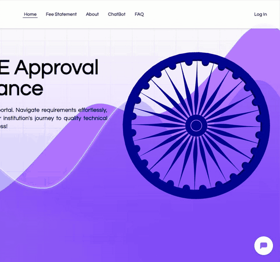
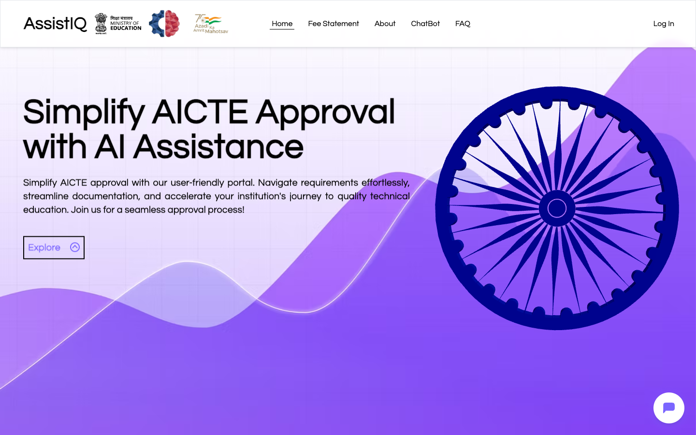
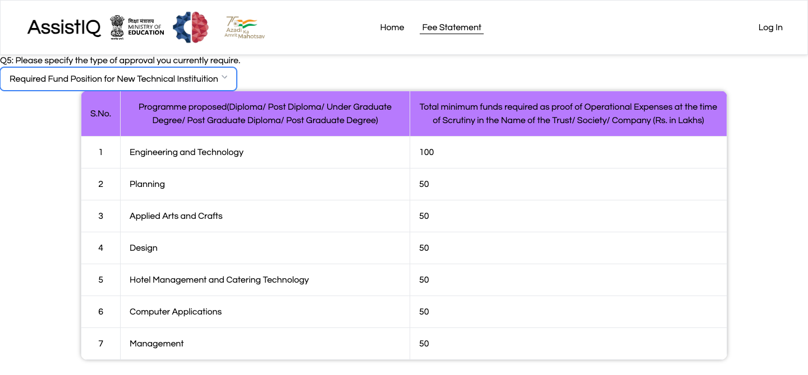
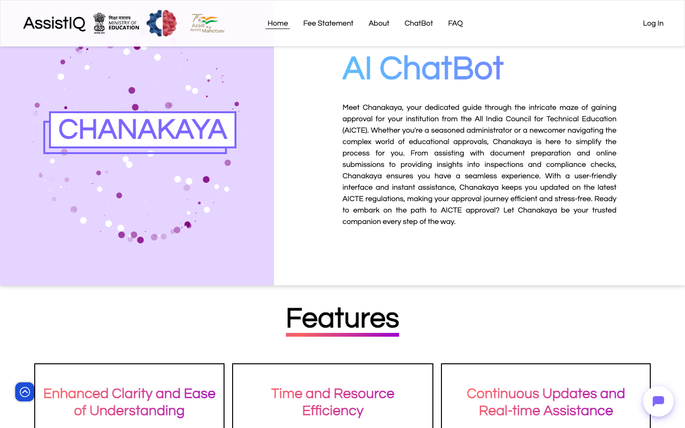
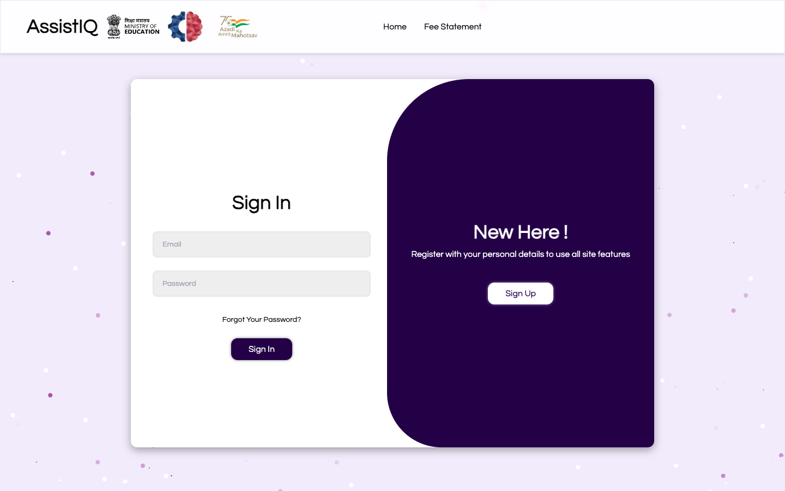
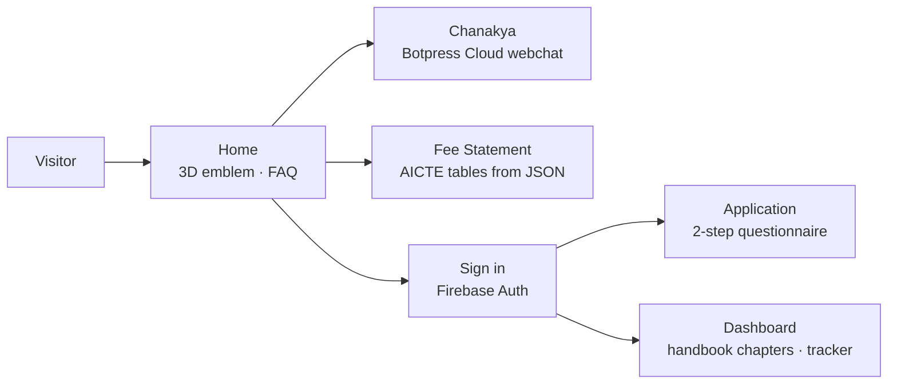

<div align="center">

# AssistIQ

**A web portal that walks engineering colleges through AICTE's approval process.**

Built by Team FusionX for Smart India Hackathon 2023 (problem statement PS1583, set by AICTE), where the team placed
**runner-up at the national finals**. AssistIQ pairs a guided chatbot, Chanakya, with the fee tables, a step-by-step
approval questionnaire and the handbook chapters, so an institute can find what applies to it without reading the
whole Approval Process Handbook.



<sub>A real recording of the live site: Chanakya's guided menu, next to the rotating 3D emblem.</sub>

**[▶ Open the live demo](https://assistiq-aicte.vercel.app)** ·
**[What's in it](#whats-in-it)** ·
**[Run it locally](#run-it-locally)** ·
**[Team](#team)**


[](LICENSE)

</div>

---

<details>
<summary><b>Contents</b></summary>

- [The problem](#the-problem)
- [What's in it](#whats-in-it)
- [Screenshots](#screenshots)
- [How it fits together](#how-it-fits-together)
- [Run it locally](#run-it-locally)
- [What changed in this fork](#what-changed-in-this-fork)
- [Limitations](#limitations)
- [Team](#team)
- [License](#license)

</details>

## The problem

Colleges in India apply to AICTE for approvals: a new institute, an extension for an existing one, a twinning
programme, a university course, or open and distance learning. The rules are in AICTE's Approval Process Handbook, a
long document that changes from year to year, and a misread requirement means rework and delays. The hackathon asked
for a way to make that process easier to follow.

## What's in it

- **Chanakya, a guided chatbot** (Botpress Cloud). The user picks a topic from menus (new institute, existing
  institute, twinning programme, university, open and distance learning) instead of typing free-form questions.
  The conversation resets on every page load.
- **Fee Statement.** Pick a category and see the matching AICTE table: TER charges, the minimum funds a new
  institute must show, and security deposits.
- **Application questionnaire** (after sign-in). Step 1 asks nine questions: the disciplines offered, the level of
  approval sought (diploma to postgraduate), the course types, the type of institution, which of five approval
  categories applies, the budget, the security deposit the institute can allocate, the legal status of its land and
  the land area. Step 2 asks the chosen category's eligibility questions. In this demo, submitting shows a notice
  instead of sending anything.
- **Dashboard** (after sign-in). The five handbook chapters as PDFs, links to AICTE's affidavit templates, and a
  progress tracker for each application (demo values).
- **Sign-in** with Firebase email and password.
- **Home page** with a 3D emblem you can drag to rotate (React Three Fiber), smooth scrolling (Lenis), an FAQ and
  an introduction to Chanakya.

## Screenshots

<table>
<tr>
<td colspan="2"></td>
</tr>
<tr>
<td width="50%"></td>
<td width="50%"></td>
</tr>
<tr>
<td align="center"><sub>Fee Statement: the required-funds table for a new institute</sub></td>
<td align="center"><sub>Chanakya's introduction on the home page</sub></td>
</tr>
<tr>
<td colspan="2" align="center"><br><sub>Sign-in, in front of the Application and Dashboard pages</sub></td>
</tr>
</table>

<sub>Captured from the live site with headless Chrome at 1440×900. The Application and Dashboard pages need an
account, so they aren't shown here.</sub>

## How it fits together



| Layer | Tech |
|---|---|
| Frontend | React 18, Vite 5, React Router, Tailwind CSS, Material Tailwind and MUI components |
| 3D and motion | three.js with React Three Fiber, Lenis smooth scrolling, react-scroll-parallax |
| Auth | Firebase Authentication (email and password) |
| Chatbot | Botpress Cloud webchat v3.7, loaded with its inject script |
| Deployment | Vercel |

During the hackathon the forms and tracker talked to a Strapi backend. That backend is no longer running, so this
fork replaces those calls with demo data (see below).

## Run it locally

```bash
git clone https://github.com/abhiishek-sharma/SIH2023.git && cd SIH2023
npm install
npm run dev
```

Sign-in uses the Firebase project configured in `src/firebase.js`; point it at your own Firebase project to use your
own accounts. The chatbot is hosted on Botpress Cloud and needs no local set-up.

## What changed in this fork

This is my fork of the team repository, [DevSankalp/SIH2023](https://github.com/DevSankalp/SIH2023). The hackathon
code is unchanged apart from these fixes, made in November 2026 so the demo works again:

- **Demo mode.** The calls to the old Strapi backend were replaced with demo data: two sample applications, fixed
  tracker values and a notice instead of a real submission.
- **Chanakya works again.** The Botpress embed was upgraded from v1 to v3.7, with a fresh conversation on every page
  load, page scrolling locked while the pointer is over the chat window, and colours matched to the site.
- **Scroll-to-top button** fixed on the home page.

## Limitations

- It's a hackathon prototype: nothing is submitted to AICTE, and the application and tracker data are demo values.
- The fee tables and questions were taken from the handbook in late 2023 and haven't been updated since.
- On the Fee Statement page, the last option ("TER Charges for ODL/OL Courses") doesn't show a table yet.
- The "Our Clients" section on the home page still has placeholder testimonials from the hackathon.
- The page loader (react-preloaders 3.0.3) hides itself on the document's `readystatechange` event
  (`lib/Preloader/StyledPreloader.js`). If the page has already finished loading when the app mounts, that event
  never comes and the loader stays on screen; this happened on every load in headless Chrome.

## Team

Team FusionX:

- Abhishek Sharma
- Sankalp Srivastava
- Anshu Kumar
- Arham Hayat
- Priyanka Lashkari
- Mst Shahria Jerin Sinthia

## License

Apache License 2.0. See [LICENSE](LICENSE).
